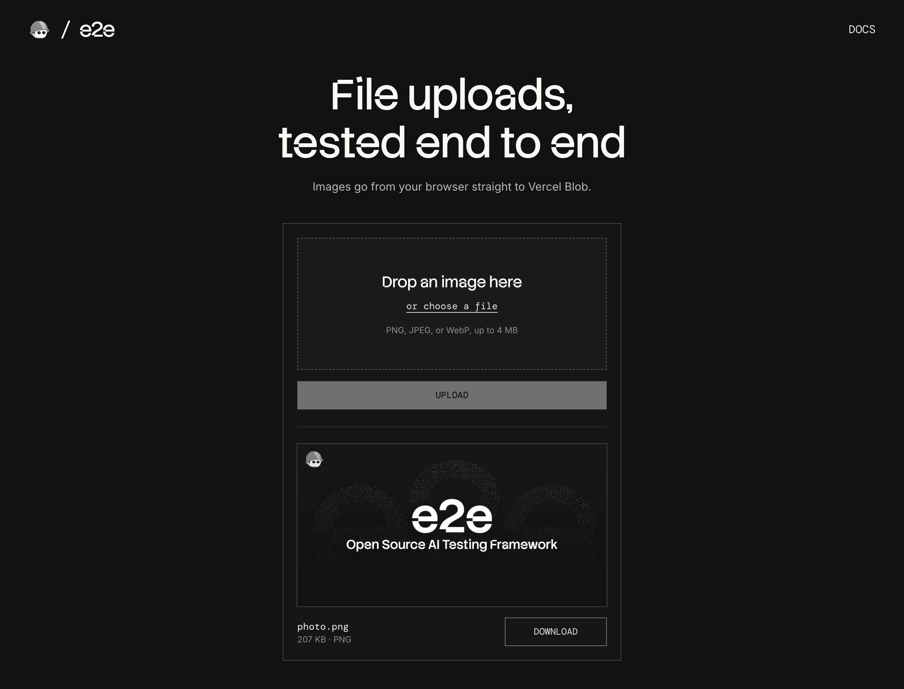

# e2e-file-upload

An image upload to Vercel Blob, used as an example of end-to-end testing file uploads, drag-and-drop, and downloads with [e2e](https://www.npmjs.com/package/e2e).



## How it works

- **Upload panel** (`components/uploader.tsx`) takes an image from the file picker or a drop, and checks its type and size before anything is sent.
- **`POST /api/upload`** (`app/api/upload/route.ts`) gives the browser a short-lived upload token with the same limits, and the browser sends the file straight to a private Vercel Blob store.
- **`GET /api/files/…`** (`app/api/files/[...pathname]/route.ts`) streams the stored file back for the preview and the Download button.

The page takes PNG, JPEG, and WebP images up to 4 MB (`lib/files.ts`). There is no database: Blob holds the files. The upload route has no sign-in, so don't deploy it as it is.

### Test files

| File                       | Result                                  |
| -------------------------- | --------------------------------------- |
| `tests/files/photo.png`    | Uploaded                                |
| `tests/files/invoice.pdf`  | Refused: not a PNG, JPEG, or WebP image |
| A 5 MB PNG the test writes | Refused: over 4 MB                      |

## Getting started

```bash
npm install
npm run dev
```

Open [http://localhost:3000](http://localhost:3000).

### Vercel Blob store

Uploads go to your own Blob store. In the [Vercel dashboard](https://vercel.com/dashboard), open **Storage → Create → Blob** and pick **Private** access. Copy `.env.example` to `.env.local` and set `BLOB_READ_WRITE_TOKEN` to the store's read-write token from its settings. Blob is free on the Hobby plan within its monthly allowance.

## End-to-end tests

`tests/upload.e2e.ts` uploads to the real store. The agent uploads `photo.png` with one goal, "upload the image tests/files/photo.png", and a screenshot check confirms the preview. The other tests use locators: the download has the same SHA-256 as the file and as the stored blob, a file named `café menu #1 (100%).png` keeps its name, a dropped file gives the same card as the picker, and Node calls the upload route directly to show that Blob refuses a 5 MB image and a PDF even when the page's checks are skipped. Each test checks the stored file through Blob's API and deletes what it uploaded.

e2e can't drag a file from the desktop, so the drop test builds the `File` in the page and sends the events a real drop sends. `tests/home.e2e.ts` checks the page's own refusals and a failed upload with locators only, and needs no keys.

The Blob tests need `BLOB_READ_WRITE_TOKEN`. The agent's model goes through the Vercel AI Gateway, so also set `AI_GATEWAY_API_KEY` (or link a Vercel project). Then, with the dev server running:

```bash
npm run test:e2e
```

To run only the Blob tests, add `--tag blob`. To test a different URL, set `APP_URL`.

## Scripts

| Command            | Description          |
| ------------------ | -------------------- |
| `npm run dev`      | Start the dev server |
| `npm run build`    | Build for production |
| `npm run lint`     | Run ESLint           |
| `npm run format`   | Format with Prettier |
| `npm run test:e2e` | Run the e2e tests    |
